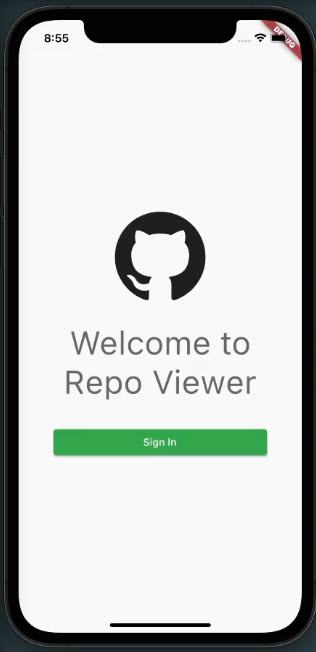
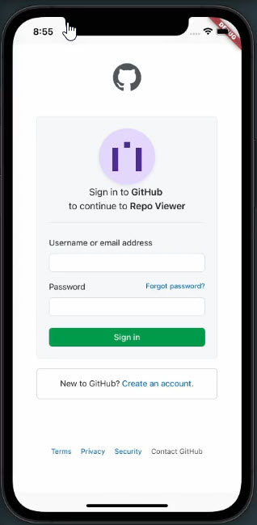

# RepoViewer

RepoViewer is a Flutter learning project developed during the Reso Coder Academy Flutter Bootcamp. It explores a mobile GitHub repository browser with OAuth authentication, repository search, starred repositories and README viewing.

The checked-in source is an unfinished learning snapshot. It contains build blockers and outdated API usage, so the commands below describe the development workflow rather than a verified, working installation. This README documents the repository as it stands; it does not imply a production-ready release.

## App functionality represented in the source

The authentication layer implements GitHub's OAuth authorization-code flow, secure credential storage and sign-out/token revocation. The requested OAuth scopes are `read:user` and `repo`.

The repository screens provide paginated starred repositories and GitHub repository search. Repository details render README HTML in a WebView, open outgoing links externally and allow changing the starred status when fresh data is available.

Sembast services cache starred repository pages, repository details and HTTP header metadata. Cached starred repositories and details can be returned when a connection is unavailable; this requires previously stored data. Search results are fetched remotely rather than cached for offline search. The local search history keeps up to ten terms.

These are implemented code paths, not features verified by running the current checkout.

## Screenshots

These images are already included in the repository and illustrate an earlier app state.





## Development prerequisites

Use the Flutter SDK with a bundled Dart SDK satisfying the declared constraint `>=3.0.1 <4.0.0` in [pubspec.yaml](pubspec.yaml). The repository does not pin a Flutter version. Dependency constraints and existing source APIs need to be reconciled before assuming compatibility with a current SDK.

For mobile development, prepare an Android device/emulator and Android toolchain, or macOS with Xcode and the iOS toolchain. Platform folders exist for Android, iOS, Linux, macOS, Windows and web, but their presence does not establish working support. The authentication UI uses `dart:io` and the older mobile WebView API; web and desktop support have not been established.

Check the local toolchain and fetch the declared dependencies from the project root:

```sh
git clone https://github.com/jonasermert/RepoViewer.git
cd RepoViewer
flutter doctor
flutter pub get
```

## GitHub OAuth configuration

Register a GitHub OAuth App in your GitHub account's developer settings. Set its authorization callback URL to `http://localhost:3000/callback`, matching `GithubAuthenticator.redirectUrl` in [github_authenticator.dart](lib/auth/infrastructure/github_authenticator.dart). The authorization WebView intercepts this redirect in the app. The old README's `http://localhost:8080` homepage value was not the callback configured in the source.

The [.env.sample](.env.sample) file documents the expected variable names. A local configuration would look like this:

```dotenv
CLIENT_ID=your_oauth_app_client_id
CLIENT_SECRET=your_oauth_app_client_secret
```

Copy the sample only as a starting point:

```sh
cp .env.sample .env
```

Creating this file alone does not configure the current app. The authenticator imports `flutter_dotenv`, but that package is absent from the declared dependencies, `.env` is not declared as a Flutter asset, and [main.dart](lib/main.dart) does not load dotenv before starting the app. Complete that wiring before attempting OAuth sign-in.

The current [.gitignore](.gitignore) also does not exclude `.env`; add a local exclusion or an appropriate ignore rule before placing real credentials there. Do not commit credentials. A secret bundled into a distributed client cannot be treated as confidential, so review the OAuth design before distributing an app built from this learning project.

## Code generation and local checks

The project uses Freezed and AutoRoute generators, with generated Dart files already checked in. After changing their source models or routes, regenerate them with:

```sh
dart run build_runner build --delete-conflicting-outputs
```

During development, the equivalent watch command is:

```sh
dart run build_runner watch --delete-conflicting-outputs
```

Once the existing source and dependency issues are resolved, use Flutter's analysis, test and run commands:

```sh
flutter analyze
flutter test
flutter run
```

These commands are provided for the repair and development workflow; successful analysis, tests or startup are not claimed for the current snapshot.

## Known limitations in the current checkout

The app entry point refers to `AppWidget`, while [app_widget.dart](lib/core/presentation/app_widget.dart) declares `AppWiget` and contains syntax errors such as `asnyc`. Imports also contain inconsistent package names and paths, including `repoviwer`, `resocoder_repo_viewer` and differing `infrastructure`/`infrastracture` spellings. Several imports therefore do not match the checked-in files.

The authenticator expects `credential_storage/credential_storage.dart`, while the repository contains `credentials_storage/credentials_storage.dart`. Some directly imported packages, including `flutter_dotenv`, `http`, `path` and `path_provider`, are not declared as direct dependencies.

The declared `webview_flutter: ^4.2.1` dependency conflicts with older calls such as `WebView`, `WebView.platform` and `SurfaceAndroidWebView`. The repository needs an API migration or an intentional dependency alignment before those screens can build.

The only checked-in test, [test/widget_test.dart](test/widget_test.dart), is the default counter example and refers to `MyApp`, which the current entry point does not define. It does not validate RepoViewer's behavior.

The [Dart workflow](.github/workflows/dart.yml) installs a standalone Dart SDK and invokes `dart pub get`, `dart analyze` and `dart test`. It does not install Flutter despite this package depending on the Flutter SDK, so it is not a working Flutter validation setup as written.

## Project organization

[lib/auth](lib/auth) contains authentication state, OAuth integration, credential storage and sign-in UI. [lib/github](lib/github) groups shared GitHub models, repository search, starred repositories and detail views. [lib/search](lib/search) contains search history and search UI, while [lib/core](lib/core) holds shared presentation, routing, networking and database support. [lib/splash](lib/splash) contains the splash screen.

Features generally separate `application`, `domain`, infrastructure and `presentation` concerns. Hooks/Riverpod provide state management, Dio handles API requests, Freezed models immutable data, AutoRoute handles navigation and Sembast provides local persistence. Existing folder spelling is retained in repository links and source references.

## Makefile notes

The [Makefile](Makefile) includes convenience targets, but some have broader side effects than their names suggest. `make run_mobile` wraps `flutter run`, and `make build_runner` cleans and regenerates generated code.

`make run_unit` currently prints a message without running tests because its test command is commented out. Use `flutter test` directly when validating tests.

`make upgrade` removes the lockfile through its clean dependency, upgrades major dependency versions and invokes icon generation even though `flutter_launcher_icons` is not declared in pubspec.yaml. `make build_ios_mobile` also invokes a commit target that stages all changes and opens an interactive commit. Use explicit Flutter commands when you need predictable setup or validation steps.

## Project context and license

This repository records coursework from the [Reso Coder Academy](https://resocoder.com/). It contains no LICENSE file, so this README does not assign an open-source license.
